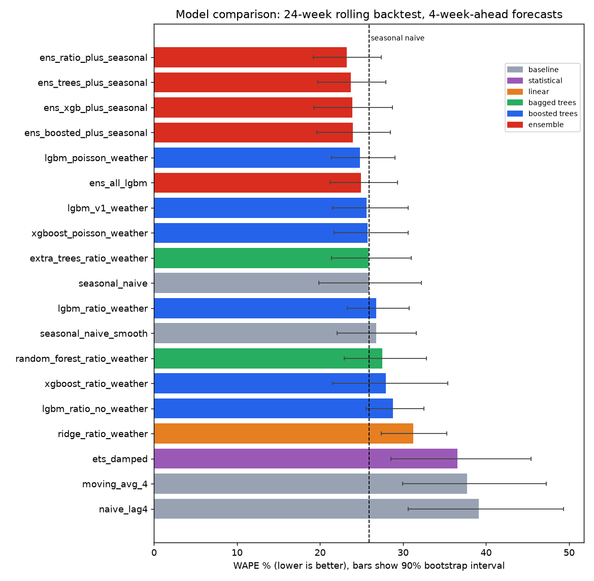
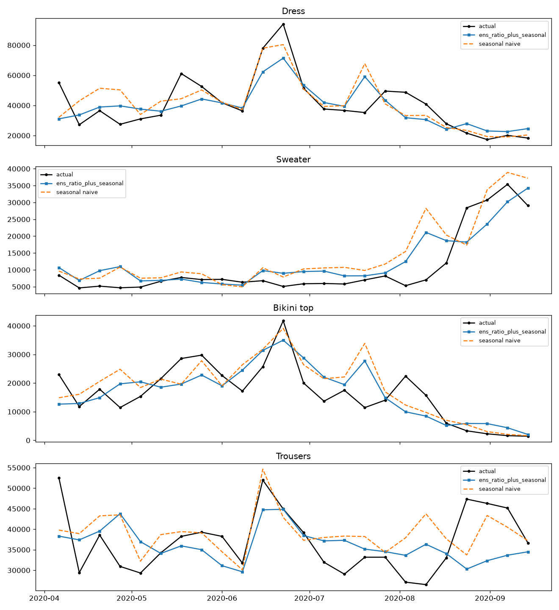
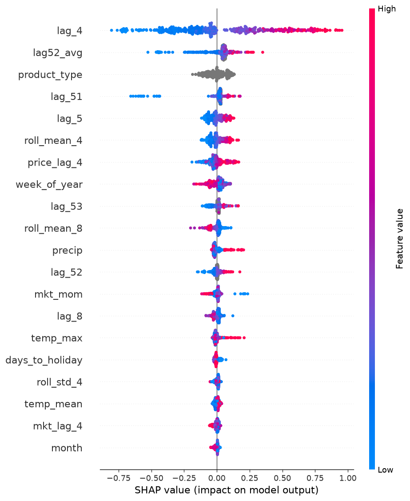
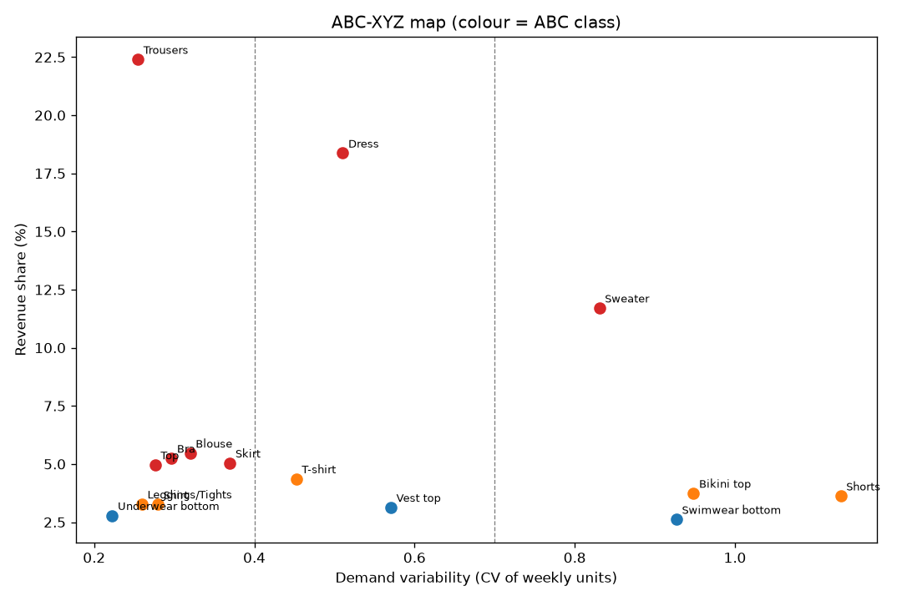
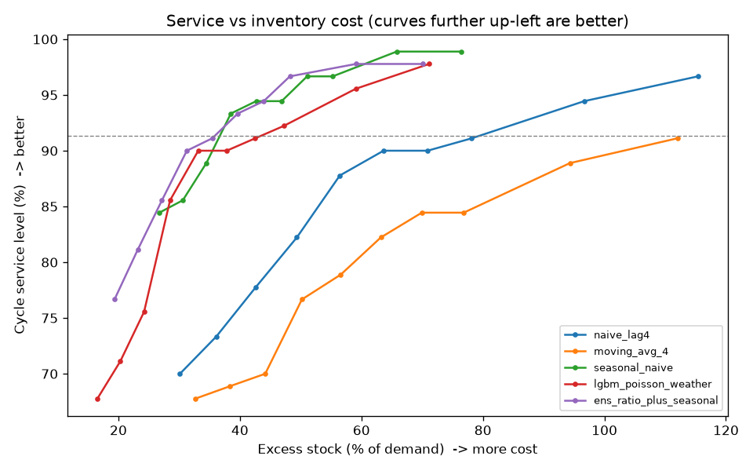

# H&M Demand Forecasting & Inventory Optimization

An end-to-end pipeline that forecasts **4-week-ahead weekly demand for 15 apparel categories** from the H&M transactions dataset, then turns those forecasts into **safety-stock and order-up-to recommendations** using ABC-XYZ segmentation and service-level targets. Results are served through a small Flask API and dashboard.

> **Why this project:** forecast accuracy only matters if it changes a decision. The goal here is not just "which model has the lowest error" but "how much stock should each category carry, and does a better forecaster actually reduce excess inventory at the same service level?"

---

## Headline results

> Replace the `[ ]` values with the numbers printed by `03b_model_benchmark.py` and `04_inventory_optimization.py`.

| | WAPE (24-week backtest, 4-week-ahead) |
|---|---|
| Seasonal-naive baseline | **[ ]%** |
| Best model (`[model name]`) | **[ ]%** (90% CI [ ] to [ ]) |
| Improvement vs baseline | **[ ] pts** |

- Models benchmarked: **[N]** across baselines, ETS, Ridge, Random Forest, Extra Trees, LightGBM, XGBoost and ensembles.
- Does the best model *clearly* beat seasonal-naive (90% bootstrap interval of the difference entirely below 0)? **[Yes / No]**
- At the same cycle-service target, the best forecaster needs **[ ]%** excess stock vs **[ ]%** for the seasonal-naive baseline.



---

## Pipeline

```
Kaggle H&M data (31M+ transactions)
        |
01_prepare_sales_data.py     chunked aggregation -> daily units/revenue per product type (top 15)
        |
02_build_features.py         weekly roll-up + Swedish holidays, Black Friday, Xmas, weather (Open-Meteo)
        |
03_train_forecast_models.py  lag/rolling/market features, LightGBM variants, 24-week rolling-origin backtest, SHAP
        |
03b_model_benchmark.py       RF, Extra Trees, XGBoost, Ridge, ETS, ensembles + block-bootstrap confidence intervals
        |
04_inventory_optimization.py ABC-XYZ segmentation, safety stock, order-up-to, policy simulation, service-vs-cost frontier
        |
05_forecast_api.py           Flask API + dashboard serving 4-week forecasts and order recommendations
```

## Approach

**Data.** `transactions_train.csv` (about 31M rows) is streamed in chunks and aggregated to daily units and revenue per product type. The 15 highest-volume product types are kept. Daily data is rolled up to complete Monday-to-Sunday weeks.

**Features.** Every lag is at least the forecast horizon (4 weeks), so each feature is known at forecast time and there is no leakage by construction.
- Lags: 4, 5, 6, 8 weeks, plus last-year lags 51, 52, 53 and their average
- Rolling mean and std of the series (shifted by the horizon)
- Market-level signals: whether the whole store was spiking in the same week last year
- Ratio features: lags expressed relative to the product's recent level, so one model works across categories of very different size
- Calendar: week of year, Swedish public holidays, days to next holiday, Black Friday, Christmas season
- Weather: temperature (mean/max/min) and precipitation from the Open-Meteo archive API

**Validation.** Rolling-origin backtest with 6 folds x 4 weeks (the last 24 weeks). Each fold trains only on data before its origin. Metrics are WAPE, RMSE and bias, always compared with a seasonal-naive baseline.

**Uncertainty.** A circular block bootstrap over weeks gives a 90% interval on each model's WAPE and on its difference from seasonal-naive. A model is only called better if that interval excludes zero.

**Inventory layer.**
- ABC (revenue share: A <= 70%, B <= 90%) x XYZ (demand variability) segmentation
- Target cycle service: A 95%, B 90%, C 85%
- Safety stock = z x relative forecast error x sqrt(sum of squared weekly forecasts) x buffer
- Order-up-to = 4-week forecast + safety stock
- Policy simulation across forecasters, plus a service-vs-cost frontier that compares forecasters **at the same service level**

## Key figures

| Backtest: actual vs predicted | Feature importance (SHAP) |
|---|---|
|  |  |

| ABC-XYZ map | Service vs inventory cost |
|---|---|
|  |  |

---

## Project structure

```
hm-demand-forecasting/
|-- src/
|   |-- config.py                      paths and settings
|   |-- 01_prepare_sales_data.py
|   |-- 02_build_features.py
|   |-- 03_train_forecast_models.py
|   |-- 03b_model_benchmark.py
|   |-- 04_inventory_optimization.py
|   |-- 05_forecast_api.py
|   `-- static/dashboard.html
|-- data/
|   |-- raw/          (not in repo: Kaggle files go here)
|   `-- processed/    daily_sales.csv, weekly_features.csv
|-- outputs/
|   |-- figures/      charts used in this README
|   `-- reports/      leaderboards, backtest predictions, inventory recommendations
|-- requirements.txt
`-- README.md
```

## How to run

```bash
git clone https://github.com/Lohithbn12/hm-demand-forecasting.git
cd hm-demand-forecasting
python -m venv .venv && source .venv/bin/activate   # Windows: .venv\Scripts\activate
pip install -r requirements.txt
```

**Option A: skip the big download.** `data/processed/` already contains `daily_sales.csv` and `weekly_features.csv`, so you can start at step 3:

```bash
cd src
python 03_train_forecast_models.py
python 03b_model_benchmark.py
python 04_inventory_optimization.py
python 05_forecast_api.py
```

**Option B: full run from raw data.**
1. Download `articles.csv` and `transactions_train.csv` from the [H&M Kaggle competition](https://www.kaggle.com/competitions/h-and-m-personalized-fashion-recommendations) into `data/raw/` (about 3.5 GB).
2. Run steps in order from `src/`:

```bash
python 01_prepare_sales_data.py
python 02_build_features.py
python 03_train_forecast_models.py
python 03b_model_benchmark.py
python 04_inventory_optimization.py
python 05_forecast_api.py
```

**API** (after step 5, at `http://127.0.0.1:5000`):

| Endpoint | Description |
|---|---|
| `/health` | service status |
| `/forecast` | 4-week forecast and order-up-to for all categories |
| `/forecast?product_type=Dress&on_hand=40000&on_order=0` | one category, with order quantity given current stock |
| `/weather/live` | live 14-day weather forecast |
| `/dashboard` | visual dashboard |

Step 2 needs internet access (Open-Meteo, free, no key). Weather is cached in `data/external/` after the first run.

---

## Limitations and honest caveats

- **Short history.** The data covers roughly two years (Sep 2018 to Sep 2020), so only about one year of rows have a last-year lag. The backtest window falls in the COVID period, which makes seasonal-naive a weaker reference than usual.
- **Model selection on the test window.** Many models were compared on the same 24 weeks, so the top score is somewhat optimistic. A clean final holdout would be a better test.
- **Weather in the backtest is actual weather**, not a forecast, so its measured benefit is an upper bound. Over two years, weather effects are also hard to separate from seasonality.
- **Stockholm is assumed** as the location, because the dataset has no store geography.
- **Prices are anonymized** in the Kaggle data, so revenue is in relative units, not currency.
- **The inventory simulation is simplified.** It uses 4-week independent cycles with no carry-over inventory, and the safety-stock buffer is calibrated on the same backtest.
- **The API is a simulated deployment.** The latest actual week in the data is Sep 2020, so the "live" forecast runs from that point using archived weather for those dates.

## Possible next steps

- Hold out the last 8 to 12 weeks untouched for a single final evaluation
- Report WAPE separately for pre-COVID and COVID weeks
- Add a test that no feature uses data newer than t-4
- Containerize the API with Docker
- Extend to SKU or store level with hierarchical reconciliation

## Tech stack

Python, pandas, NumPy, LightGBM, XGBoost, scikit-learn, statsmodels, SHAP, matplotlib, Flask, Open-Meteo API

## Author

**Lohith B N**: Data Analyst moving into Data Science.
[GitHub](https://github.com/Lohithbn12) | [LinkedIn](https://www.linkedin.com/in/) <!-- add your LinkedIn URL -->

## Data and license

Data: [H&M Personalized Fashion Recommendations](https://www.kaggle.com/competitions/h-and-m-personalized-fashion-recommendations) (Kaggle). Raw data is not redistributed here; please follow the competition's terms of use.
